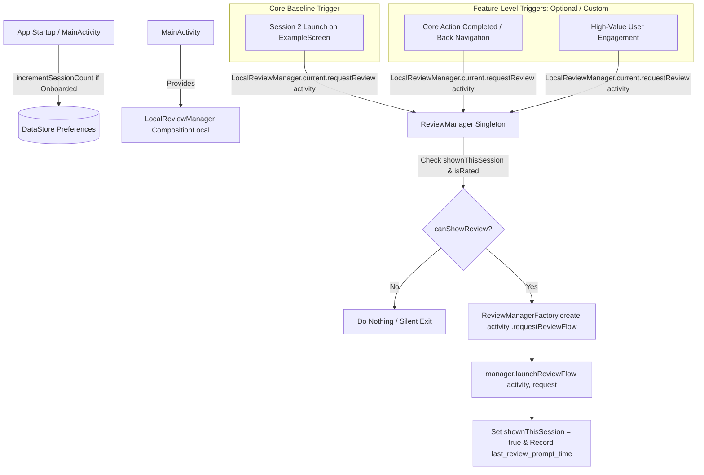

# Google Play In-App Review & Rating Module Specification

## Repository adaptation notes

Imported user-provided reference: source language, implementation snippets, schemas and detailed
checklists are retained. Packages use `com.example.app`; feature entry points use `Example` names.
Snippets are reference code, not installed or compiled application code. Repository instructions
and the adaptation notes below take precedence when implementing them. Dependency versions are
retained source examples, not newly verified version recommendations. Tests, SDK installation,
remote configuration changes, publication and uploads are not performed by importing this file.

- Session 2 and optional feature triggers are retained reference strategies, not automatic
  authorization to add new prompts. Keep update/review ordering from this source.
- Count once per defined app process session, not once per Activity recreation. Claim a review
  attempt synchronously before suspending so multiple triggers cannot pass the guard together.
- A completed Play review flow does not prove a dialog was shown, a rating was selected or a
  review was submitted. Treat `APP_RATED` as an explicit app preference only; do not set it from
  task completion or store navigation. `shownThisSession` is an attempt guard, not visibility proof.
- Await launch task completion where needed; propagate cancellation in the sample's broad catches.
  Recheck visible/resumed host and update-dialog eligibility after delays, without retaining Activity.
- Inject a clock for prompt timestamps and use a lifecycle-aware owner. Debug mock presentation
  remains a debug-only verification aid, not evidence that the Play dialog appeared.
- Navigation results must use the existing serializable NavKey/entry ownership contract; the
  `savedStateHandle` flag below is a reference pattern, not a requirement to change navigation APIs.

Related contracts: [App update](app_update_specification.md),
[Core modules](../core_modules_specification.md), [Firebase](../firebase.md).

---

> **Mục đích tài liệu:** Đóng gói toàn bộ kiến trúc, mã nguồn mẫu, chiến lược trigger chuẩn (Session 2 Launch), các lưu ý quan trọng và danh sách các lỗi (bug fixes / edge cases) đã giải quyết trong quá trình triển khai tính năng **In-App Review / App Rating** trên Android Jetpack Compose. Tài liệu này được thiết kế tổng quát (generic) để AI Agent hoặc Developer có thể tích hợp trực tiếp vào bất kỳ ứng dụng mới nào.

---

## 1. Tổng quan kiến trúc (Architecture Overview)

Tính năng Rating & Review sử dụng thư viện chính thức **Google Play In-App Review API** kết hợp với **DataStore Preferences**, **Hilt Dependency Injection**, và **CompositionLocal** trong Jetpack Compose.



### Thành phần cốt lõi:
1. **`ReviewManager`**: Singleton quản lý logic kiểm tra điều kiện hiển thị, đếm session, gọi Google Play API và lưu vết vào DataStore.
2. **`LocalReviewManager`**: `staticCompositionLocalOf<ReviewManager>` giúp các Composable màn hình dễ dàng gọi `reviewManager.requestReview(context as Activity)` mà không cần truyền callback qua nhiều tầng giao diện hay ViewModel.
3. **`DataStore Keys`**: Lưu trữ trạng thái đã rate, số lượng session hợp lệ sau onboarding, và thời điểm prompt gần nhất.

---

## 2. Dependencies & Gradle Setup

### `gradle/libs.versions.toml`
```toml
[versions]
playReview = "2.0.2"

[libraries]
play-review-ktx = { group = "com.google.android.play", name = "review-ktx", version.ref = "playReview" }
```

### `app/build.gradle.kts`
```kotlin
dependencies {
    implementation(libs.play.review.ktx)
    // Hỗ trợ .await() cho Task của Google Play Services
    implementation("org.jetbrains.kotlinx:kotlinx-coroutines-play-services:1.8.1")
    // DataStore Preferences
    implementation(libs.androidx.datastore.preferences)
}
```

---

## 3. DataStore Preferences Keys

Định nghĩa các key cần thiết trong `PreferencesKeys.kt`:

```kotlin
package com.example.app.core.datastore

import androidx.datastore.preferences.core.booleanPreferencesKey
import androidx.datastore.preferences.core.intPreferencesKey
import androidx.datastore.preferences.core.longPreferencesKey

object PreferencesKeys {
    val APP_RATED = booleanPreferencesKey("app_rated")
    val APP_SESSION_COUNT = intPreferencesKey("app_session_count")
    val LAST_REVIEW_PROMPT_TIME = longPreferencesKey("last_review_prompt_time")
    val ONBOARDING_COMPLETED = booleanPreferencesKey("onboarding_completed")
}
```

---

## 4. Triển khai Mã nguồn Chi tiết

### 4.1. `ReviewManager.kt`
File: `core/review/ReviewManager.kt`

```kotlin
package com.example.app.core.review

import android.app.Activity
import android.app.AlertDialog
import androidx.compose.runtime.staticCompositionLocalOf
import androidx.datastore.core.DataStore
import androidx.datastore.preferences.core.Preferences
import androidx.datastore.preferences.core.edit
import com.google.android.play.core.review.ReviewManagerFactory
import com.example.app.BuildConfig
import com.example.app.core.datastore.PreferencesKeys
import kotlinx.coroutines.flow.first
import kotlinx.coroutines.flow.map
import kotlinx.coroutines.tasks.await
import javax.inject.Inject
import javax.inject.Singleton

val LocalReviewManager = staticCompositionLocalOf<ReviewManager> {
    error("No ReviewManager provided")
}

/**
 * Manages in-app rating and review prompts using Google Play In-App Review API.
 */
@Singleton
class ReviewManager @Inject constructor(
    private val dataStore: DataStore<Preferences>
) {
    /**
     * Prevents triggering the review dialog multiple times in the same application process session.
     */
    private var shownThisSession = false

    /**
     * Checks if the rating dialog can be shown based on session & rating history.
     */
    suspend fun canShowReview(): Boolean {
        // Only allow 1 prompt attempt per app runtime session
        if (shownThisSession) return false
        
        val prefs = dataStore.data.first()
        val isRated = prefs[PreferencesKeys.APP_RATED] ?: false
        if (isRated) return false
        
        return true
    }

    /**
     * Requests and launches the Google Play In-App Review flow.
     *
     * Note: Google Play strictly throttles in-app review dialogs. The API might
     * complete successfully without showing any dialog if quota is exceeded.
     * The app must NOT rely on the dialog being visible to continue normal flow.
     */
    suspend fun requestReview(activity: Activity) {
        if (!canShowReview()) return

        // Uncomment for debug mock testing if needed:
        // if (BuildConfig.DEBUG) {
        //     showFakeReviewPopup(activity)
        //     shownThisSession = true
        //     return
        // }

        val manager = ReviewManagerFactory.create(activity)
        val request = try {
            val reviewInfoTask = manager.requestReviewFlow()
            reviewInfoTask.await()
        } catch (e: Exception) {
            null
        }

        if (request != null) {
            try {
                manager.launchReviewFlow(activity, request)
                shownThisSession = true
                dataStore.edit { 
                    it[PreferencesKeys.LAST_REVIEW_PROMPT_TIME] = System.currentTimeMillis() 
                }
            } catch (e: Exception) {
                // Ignore failure - do not break user experience
            }
        }
    }

    /**
     * Displays a mock popup dialog for debugging review triggers without Google Play limitations.
     */
    fun showFakeReviewPopup(activity: Activity) {
        activity.runOnUiThread {
            AlertDialog.Builder(activity)
                .setTitle("Debug: App Review Triggered")
                .setMessage("This is a mock popup to test the rating flow in debug mode.")
                .setPositiveButton("OK") { dialog, _ ->
                    dialog.dismiss()
                }
                .setCancelable(true)
                .show()
        }
    }

    /**
     * Marks that the user has rated the app (e.g. from an in-app settings button).
     */
    suspend fun markRated() {
        dataStore.edit { it[PreferencesKeys.APP_RATED] = true }
    }

    /**
     * Increments session count ONLY if the user has already completed the onboarding flow.
     * Crucial to avoid premature rating prompts if onboarding is exited midway.
     */
    suspend fun incrementSessionCount() {
        dataStore.edit {
            val onboardingCompleted = it[PreferencesKeys.ONBOARDING_COMPLETED] == true
            if (onboardingCompleted) {
                val current = it[PreferencesKeys.APP_SESSION_COUNT] ?: 0
                it[PreferencesKeys.APP_SESSION_COUNT] = current + 1
            }
        }
    }

    /**
     * Observes the current valid session count.
     */
    fun getSessionCount() = dataStore.data.map { it[PreferencesKeys.APP_SESSION_COUNT] ?: 0 }
}
```

---

## 5. Tích hợp vào Entry Points & UI

### 5.1. Khởi tạo và cung cấp CompositionLocal trong `MainActivity.kt`

```kotlin
@AndroidEntryPoint
class MainActivity : ComponentActivity() {

    @Inject
    lateinit var reviewManager: ReviewManager

    override fun onCreate(savedInstanceState: Bundle?) {
        super.onCreate(savedInstanceState)

        // Tăng session count khi mở app (chỉ tính khi đã xong Onboarding)
        lifecycleScope.launch {
            reviewManager.incrementSessionCount()
        }

        setContent {
            CompositionLocalProvider(
                LocalReviewManager provides reviewManager
            ) {
                AppNavGraph(...)
            }
        }
    }
}
```

### 5.2. Khởi tạo Session Count khi hoàn thành Onboarding (`OnboardingViewModel.kt`)

Khi người dùng hoàn tất Onboarding lần đầu, cần đặt `APP_SESSION_COUNT = 1` để lần mở app tiếp theo được tính chính xác là **Session 2**.

```kotlin
fun completeOnboarding() {
    viewModelScope.launch {
        dataStore.edit { prefs ->
            prefs[PreferencesKeys.ONBOARDING_COMPLETED] = true
            
            // Khởi tạo session count = 1 khi vừa xong Onboarding
            val currentSession = prefs[PreferencesKeys.APP_SESSION_COUNT] ?: 0
            if (currentSession == 0) {
                prefs[PreferencesKeys.APP_SESSION_COUNT] = 1
            }
        }
        emitEvent(OnboardingEvent.NavigateToMain)
    }
}
```

---

## 6. Chiến Lược Kích Hoạt Đánh Giá (Trigger Strategy)

### 6.1. Trigger Chuẩn Mặc Định (Core Baseline Trigger): **Session 2 Launch**

Đây là trigger cơ bản và phổ biến nhất áp dụng cho mọi ứng dụng: **Người dùng mở app lần thứ 2 sau khi đã hoàn thành Onboarding** và đang ở màn hình chính (ExampleScreen).

> **Lưu ý đồng bộ cùng App Update:** Quá trình trigger Review tại `ExampleScreen` cần đợi quá trình kiểm tra App Update qua Remote Config hoàn tất (`state.isUpdateCheckCompleted == true`) và không có popup Update nào đang hiển thị (`state.updateDialog is UpdateDialogState.None`).

```kotlin
// Trong ExampleScreen / ExampleScreen (khi màn hình chính hiển thị và đang ở top backstack)
val reviewManager = LocalReviewManager.current
val context = LocalContext.current
var hasCheckedLaunchReview by rememberSaveable { mutableStateOf(false) }

LaunchedEffect(isVisible, state.isUpdateCheckCompleted, state.updateDialog) {
    if (!isVisible || hasCheckedLaunchReview || !state.isUpdateCheckCompleted) return@LaunchedEffect
    if (state.updateDialog !is UpdateDialogState.None) return@LaunchedEffect

    val sessionCount = reviewManager.getSessionCount().first()
    if (sessionCount == 2) {
        delay(800)
        (context as? Activity)?.let { activity ->
            reviewManager.requestReview(activity)
        }
        hasCheckedLaunchReview = true
    } else {
        hasCheckedLaunchReview = true
    }
}
```

---

### 6.2. Hướng dẫn tích hợp cho các tính năng khác (Feature-Level Integration Guidelines)

Các tính năng cụ thể trong ứng dụng mới khi phát triển có thể gắn thêm lời gọi Rating nếu phù hợp với hành trình người dùng (khoảnh khắc hài lòng / Happy Moments):

#### 1. Sau khi hoàn thành hành động cốt lõi (Core Feature Action Success)
- **Kịch bản:** Người dùng tạo mới dữ liệu, xuất file, chỉnh sửa thành công và nhấn quay về (Back) danh sách.
- **Pattern thực hiện:**
  - Khi pop backstack hoặc nhận event thành công, khởi chạy Coroutine kèm `delay(500)` trước khi gọi `requestReview(activity)` để tránh xung đột với animation chuyển màn hình.

#### 2. Sau khi tương tác giá trị cao (High-Value Engagement / Milestone)
- **Kịch bản:** Người dùng hoàn thành một nhiệm vụ, đạt mốc sử dụng (streak, lưu bookmark, thêm vào danh sách ưu thích,...).
- **Pattern thực hiện:**
  - Lắng nghe One-shot Event từ ViewModel hoặc sự kiện đóng BottomSheet/Dialog để kích hoạt `reviewManager.requestReview(activity)`.

---

## 7. Các Bug Đã Fix & Lưu Ý Kỹ Thuật (Lessons Learned)

| Vấn đề gặp phải | Nguyên nhân gốc rễ (Root Cause) | Giải pháp xử lý triệt để (Solution) |
| :--- | :--- | :--- |
| **Dialog Rating hiện sai thời điểm (hiển thị ngay lần đầu vào ExampleScreen)** | `incrementSessionCount()` bị gọi mỗi khi mở app mà không kiểm tra Onboarding. Nếu người dùng mở app 2 lần trong lúc đang Onboarding rồi mới vào ExampleScreen, session count đã là 2. | 1. Chỉ tăng `APP_SESSION_COUNT` khi `ONBOARDING_COMPLETED == true`.<br>2. Khi kết thúc Onboarding, chủ động gán `APP_SESSION_COUNT = 1` trong DataStore để lần mở tiếp theo mới là session 2. |
| **Không hiển thị dialog khi nhấn Back hoặc đổi màn hình** | Gọi `requestReview` ngay khi quá trình pop backstack hoặc animation chuyển cảnh đang diễn ra, khiến Activity context chưa sẵn sàng hoặc Fragment/Screen bị detach. | Khởi chạy qua Coroutine trên scope phù hợp kèm `delay(500)` để đảm bảo animation chuyển màn hình đã kết thúc trước khi gọi review. |
| **Dialog không hiển thị khi test trên máy thật** | Google Play In-App Review có **Quota hạn chế nghiêm ngặt** (chỉ hiển thị một số lần nhất định trong khoảng thời gian nhất định và yêu cầu app phải được tải từ Google Play). | 1. Không bao giờ phụ thuộc vào việc dialog có hiện hay không (app flow tiếp tục bình thường).<br>2. Hỗ trợ hàm `showFakeReviewPopup(activity)` trong Debug mode để QA/Dev kiểm tra vị trí trigger. |
| **Bị gọi lặp lại nhiều lần trong cùng 1 phiên mở app** | Khi có nhiều trigger point khác nhau, mỗi hành động của user lại kích hoạt gọi review. | Sử dụng biến cờ `shownThisSession = true` trong Singleton `ReviewManager` để **chỉ cho phép thực thi tối đa 1 lần duy nhất trong toàn bộ vòng đời phiên chạy app**. |
| **Xung đột hiển thị cùng lúc với App Update Dialog** | Cả 2 popup (Update và Review) đều lắng nghe sự kiện mở ExampleScreen, có thể hiển thị đè lên nhau gây lỗi UX. | **Quy tắc ưu tiên:**<br>1. *Force Update*: Ưu tiên tuyệt đối, chặn hoàn toàn không hiển thị Review.<br>2. *Recommend Update*: Không hiển thị chồng lấn. Khi user đóng popup Recommend (chọn Ignore), sau đó ExampleScreen mới trigger kiểm tra và hiển thị Review (nếu đủ điều kiện). Cài đặt qua `LaunchedEffect(isVisible, state.isUpdateCheckCompleted, state.updateDialog)` chỉ gọi Review khi `isUpdateCheckCompleted == true` và `updateDialog is UpdateDialogState.None`. |
| **Lỗi mất Review sau khi bấm Ignore Recommend Update** | Gán cờ `hasCheckedLaunchReview = true` trước `delay()` hoặc trước khi Remote Config check update hoàn tất. Khi update dialog xuất hiện, coroutine bị cancel nhưng cờ đã là `true`, khiến lúc bấm Ignore không bao giờ chạy lại review. | 1. Thêm `isUpdateCheckCompleted: Boolean` vào `UiState` để chờ Remote Config hoàn tất.<br>2. Chỉ gán `hasCheckedLaunchReview = true` *bên trong* khối thực thi sau khi đã gọi `requestReview()` hoặc xác nhận không thỏa điều kiện Session. |

---

## 8. Hướng Dẫn Kiểm Thử (Testing & QA Guide)

1. **Kiểm thử trên Local / Debug:**
   - Mở comment dòng gọi `showFakeReviewPopup(activity)` trong `ReviewManager.requestReview` để hiển thị AlertDialog mock, xác minh các trigger point kích hoạt đúng lúc.
2. **Kiểm thử với Google Play:**
   - Upload file AAB lên **Google Play Console** (kênh **Internal App Sharing** hoặc **Internal Test Track**).
   - Đảm bảo tài khoản Google trên thiết bị test nằm trong danh sách Tester. Bản tải về qua Internal App Sharing cho phép hiển thị Review Dialog mà không bị giới hạn Quota.

---

## 9. Checklist Tích Hợp Cho Dự Án Mới

- [ ] Thêm dependency `play-review-ktx` và `kotlinx-coroutines-play-services` vào Gradle.
- [ ] Thêm các key `APP_RATED`, `APP_SESSION_COUNT`, `LAST_REVIEW_PROMPT_TIME`, `ONBOARDING_COMPLETED` vào DataStore.
- [ ] Tạo class `ReviewManager` và cung cấp qua `LocalReviewManager` trong `MainActivity`.
- [ ] Gọi `reviewManager.incrementSessionCount()` trong `MainActivity.onCreate()`.
- [ ] Đảm bảo `OnboardingViewModel` gán `APP_SESSION_COUNT = 1` khi hoàn thành Onboarding.
- [ ] Tích hợp **Session 2 Launch** tại ExampleScreen làm trigger mặc định.
- [ ] (Tuỳ chọn) Tích hợp thêm các trigger tại các tính năng cụ thể sau này theo hướng dẫn ở Mục 6.2.
