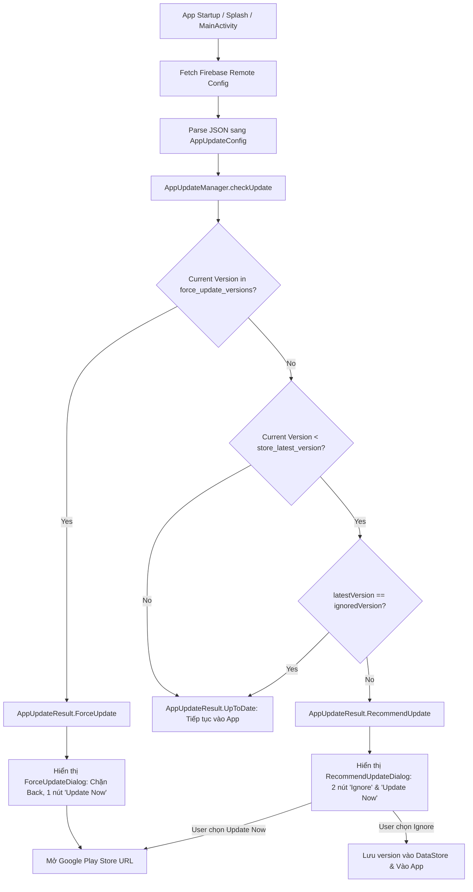

# Google Play App Update (Recommend & Force Update) Specification

## Repository adaptation notes

Imported user-provided reference: source language, implementation snippets, schemas and detailed
checklists are retained. Packages use `com.example.app`; feature entry points use `Example` names.
Snippets are reference code, not installed or compiled application code. Repository instructions
and the adaptation notes below take precedence when implementing them. Dependency versions are
retained source examples, not newly verified version recommendations. Tests, SDK installation,
remote configuration changes, publication and uploads are not performed by importing this file.

- The supplied snake_case Remote Config JSON is the reference schema. It replaces the earlier
  illustrative camelCase payload. Both dialogs block Back/outside dismiss in this reference;
  only the explicit Recommend Ignore action persists the exact ignored version.
- The numeric-segment comparator shown below is not full SemVer. Its digit-prefix and zero
  fallback behavior for malformed/overflowing segments must be reviewed before implementation.
- The supplied mapper is synchronous. In coroutine integration, rethrow cancellation rather
  than swallowing it in `runCatching`; fetch failure evaluates activated cache/default config.
- Shared dialogs must use the app's existing token/component APIs and in-flight launch guards.
  Validate the configured destination and retain recoverable state on store-launch failure;
  opening the store does not prove an update was installed.
- Check once per valid feature owner as shown; the integration checklist must not accidentally
  reintroduce the root-level prompt that the source's lessons explicitly avoid.

Related contracts: [Rating and review](app_rating_review_specification.md),
[Core modules](../core_modules_specification.md), [Design system](../design-system.md).

---

> **Mục đích tài liệu:** Đóng gói toàn bộ kiến trúc, mô hình dữ liệu (Remote Config JSON Schema), logic so khớp phiên bản (Semantic Versioning), xử lý lưu vết (DataStore), giao diện Compose (Dialogs), cùng các lưu ý kỹ thuật và giải pháp xử lý lỗi (edge cases / bug fixes) cho tính năng **App Update (Force Update & Recommend Update)** trên Android Jetpack Compose. Tài liệu được thiết kế tổng quát (generic) để AI Agent hoặc Developer có thể tích hợp trực tiếp vào bất kỳ ứng dụng mới nào.

---

## 1. Tổng quan kiến trúc (Architecture Overview)

Hệ thống App Update hoạt động dựa trên cơ chế cấu hình động qua **Firebase Remote Config** kết hợp với **DataStore Preferences** để lưu vết phiên bản người dùng đã bỏ qua (Ignore) và **Jetpack Compose Dialogs** hiển thị trên cùng (Overlay).



---

## 2. Remote Config JSON Schema & Cấu Hình

### Key Remote Config: `app_update_config`

### Cấu trúc JSON chuẩn:
```json
{
  "store_url": "https://play.google.com/store/apps/details?id=com.example.app",
  "store_latest_version": "1.2.0",
  "force_update_versions": [
    "1.0.0",
    "1.0.1",
    "1.1.0"
  ],
  "dialogs": {
    "recommend_update": {
      "title": "Update Available",
      "description": "A new version of the app is available! We recommend updating for a better experience. Would you like to update now?",
      "positive_button": "Update Now",
      "negative_button": "Ignore"
    },
    "force_update": {
      "title": "Update Required",
      "description": "A critical new version of the app is available. Please update to continue using the app.",
      "positive_button": "Update Now"
    }
  }
}
```

### Chi tiết các trường (Fields Description):
| Trường | Kiểu dữ liệu | Bắt buộc | Mô tả |
| :--- | :--- | :---: | :--- |
| `store_url` | String | Có | Đường dẫn mở trang ứng dụng trên Google Play Store (hoặc App Store). |
| `store_latest_version` | String | Có | Phiên bản mới nhất đang có trên Store (dạng `x.y.z`). Dùng để kích hoạt Recommend Update. |
| `force_update_versions` | Array[String] | Không | Danh sách các phiên bản cũ bắt buộc phải cập nhật (Force Update). |
| `dialogs.recommend_update` | Object | Không | Tùy chỉnh tiêu đề, nội dung và nhãn nút của popup Recommend Update. |
| `dialogs.force_update` | Object | Không | Tùy chỉnh tiêu đề, nội dung và nhãn nút của popup Force Update. |

### JSON Fallback Mặc Định (Tránh crash khi chưa có mạng/chưa load được config):
```kotlin
const val DEFAULT_APP_UPDATE_CONFIG_JSON: String = """
{
  "store_url": "",
  "store_latest_version": "0.0.0",
  "force_update_versions": [],
  "dialogs": {
    "recommend_update": {
      "title": "Update Available",
      "description": "A new version of the app is available! We recommend updating for better experience. Would you like to update it now?",
      "positive_button": "Update Now",
      "negative_button": "Ignore"
    },
    "force_update": {
      "title": "Update Available",
      "description": "A new version of the app is available! Please update to continue using the app.",
      "positive_button": "Update Now"
    }
  }
}
"""
```

---

## 3. Data Models & Domain Contracts

### 3.1. `AppUpdateConfig.kt` & `UpdateDialogContent.kt`
File: `core/update/AppUpdateConfig.kt`

```kotlin
package com.example.app.core.update

/**
 * Domain model chứa toàn bộ cấu hình update được parse từ Remote Config.
 */
data class AppUpdateConfig(
    val storeUrl: String = "",
    val storeLatestVersion: String = "0.0.0",
    val forceUpdateVersions: List<String> = emptyList(),
    val recommendUpdateDialog: RecommendUpdateDialogContent = RecommendUpdateDialogContent(),
    val forceUpdateDialog: ForceUpdateDialogContent = ForceUpdateDialogContent(),
)

data class RecommendUpdateDialogContent(
    val title: String = "Update Available",
    val description: String = "A new version of the app is available! We recommend updating for better experience. Would you like to update it now?",
    val positiveButton: String = "Update Now",
    val negativeButton: String = "Ignore",
)

data class ForceUpdateDialogContent(
    val title: String = "Update Available",
    val description: String = "A new version of the app is available! Please update to continue using the app.",
    val positiveButton: String = "Update Now",
)
```

### 3.2. `AppUpdateResult.kt`
File: `core/update/AppUpdateResult.kt`

```kotlin
package com.example.app.core.update

/**
 * Kết quả sau khi phân tích phiên bản hiện tại so với cấu hình update.
 */
sealed interface AppUpdateResult {

    /** Ứng dụng đang ở phiên bản mới nhất hoặc không có yêu cầu update. */
    data object UpToDate : AppUpdateResult

    /** Bắt buộc phải cập nhật mới được tiếp tục sử dụng. */
    data class ForceUpdate(
        val storeUrl: String,
        val dialog: ForceUpdateDialogContent,
    ) : AppUpdateResult

    /** Có phiên bản mới hơn, người dùng có thể cập nhật hoặc bỏ qua. */
    data class RecommendUpdate(
        val storeUrl: String,
        val latestVersion: String,
        val dialog: RecommendUpdateDialogContent,
    ) : AppUpdateResult
}
```

---

## 4. Core Logic: `AppUpdateManager.kt`

File: `core/update/AppUpdateManager.kt`

> **Điểm cốt lõi:**
> 1. Sử dụng thuật toán so sánh phiên bản phân tách theo từng cụm số (Semantic Versioning: `1.10.0` > `1.2.0`).
> 2. Phân tách rõ ràng giữa hàm thuần túy `checkUpdate()` và hàm truy xuất I/O DataStore `getIgnoredVersion()`.

```kotlin
package com.example.app.core.update

import androidx.datastore.core.DataStore
import androidx.datastore.preferences.core.Preferences
import androidx.datastore.preferences.core.edit
import androidx.datastore.preferences.core.stringPreferencesKey
import kotlinx.coroutines.flow.first
import javax.inject.Inject
import javax.inject.Singleton

private val IGNORED_RECOMMEND_UPDATE_VERSION =
    stringPreferencesKey("ignored_recommend_update_version")

@Singleton
class AppUpdateManager @Inject constructor(
    private val dataStore: DataStore<Preferences>,
) {

    /**
     * Xác định trạng thái update của ứng dụng.
     *
     * Thứ tự ưu tiên:
     * 1. ForceUpdate: Phiên bản hiện tại nằm trong danh sách [AppUpdateConfig.forceUpdateVersions].
     * 2. RecommendUpdate: Phiên bản hiện tại nhỏ hơn [AppUpdateConfig.storeLatestVersion].
     * 3. UpToDate: Đang ở phiên bản mới nhất.
     */
    fun checkUpdate(config: AppUpdateConfig, currentVersion: String): AppUpdateResult {
        val trimmed = currentVersion.trim()

        // 1. Kiểm tra Force Update trước
        if (config.forceUpdateVersions.any { compareVersions(it.trim(), trimmed) == 0 }) {
            return AppUpdateResult.ForceUpdate(
                storeUrl = config.storeUrl,
                dialog = config.forceUpdateDialog,
            )
        }

        // 2. Kiểm tra Recommend Update nếu phiên bản hiện tại cũ hơn phiên bản trên Store
        if (isOlderThan(trimmed, config.storeLatestVersion.trim())) {
            return AppUpdateResult.RecommendUpdate(
                storeUrl = config.storeUrl,
                latestVersion = config.storeLatestVersion.trim(),
                dialog = config.recommendUpdateDialog,
            )
        }

        return AppUpdateResult.UpToDate
    }

    /**
     * Lưu lại phiên bản mà người dùng đã bấm "Ignore".
     * Các lần mở app sau đối với phiên bản này sẽ không hiển thị lại popup nữa.
     */
    suspend fun ignoreRecommendVersion(version: String) {
        dataStore.edit { prefs ->
            prefs[IGNORED_RECOMMEND_UPDATE_VERSION] = version
        }
    }

    /**
     * Lấy phiên bản người dùng đã bấm Ignore gần nhất.
     */
    suspend fun getIgnoredVersion(): String? =
        dataStore.data.first()[IGNORED_RECOMMEND_UPDATE_VERSION]
            ?.takeIf { it.isNotBlank() }

    // ── Version Comparison Helpers ────────────────────────────────────────────

    /** Trả về true nếu [version] nhỏ hơn [other]. */
    private fun isOlderThan(version: String, other: String): Boolean =
        compareVersions(version, other) < 0

    /**
     * So sánh 2 chuỗi version theo chuẩn số học (VD: "1.10.0" > "1.2.0").
     */
    private fun compareVersions(left: String, right: String): Int {
        val leftParts = left.toVersionParts()
        val rightParts = right.toVersionParts()
        val size = maxOf(leftParts.size, rightParts.size)
        for (index in 0 until size) {
            val leftPart = leftParts.getOrElse(index) { 0 }
            val rightPart = rightParts.getOrElse(index) { 0 }
            if (leftPart != rightPart) return leftPart.compareTo(rightPart)
        }
        return 0
    }

    private fun String.toVersionParts(): List<Int> =
        split('.')
            .map { part -> part.takeWhile(Char::isDigit).toIntOrNull() ?: 0 }
}
```

---

## 5. Parser An Toàn (Remote Config Mapper)

File: `core/update/AppUpdateRemoteConfigMapper.kt`

> Đảm bảo không bao giờ crash app khi Remote Config bị rỗng, null hoặc sai định dạng JSON.

```kotlin
package com.example.app.core.update

import com.example.app.core.update.AppUpdateConfig
import com.example.app.core.update.ForceUpdateDialogContent
import com.example.app.core.update.RecommendUpdateDialogContent
import kotlinx.serialization.json.Json
import kotlinx.serialization.json.contentOrNull
import kotlinx.serialization.json.jsonArray
import kotlinx.serialization.json.jsonObject
import kotlinx.serialization.json.jsonPrimitive

object AppUpdateRemoteConfigMapper {

    fun toAppUpdateConfig(json: Json, rawValue: String): AppUpdateConfig = runCatching {
        val payload = json.parseToJsonElement(
            rawValue.takeIf { it.isNotBlank() } ?: DEFAULT_APP_UPDATE_CONFIG_JSON,
        ).jsonObject

        val storeUrl = payload["store_url"]?.jsonPrimitive?.contentOrNull.orEmpty()
        val storeLatestVersion = payload["store_latest_version"]?.jsonPrimitive?.contentOrNull
            ?.trim()?.takeIf { it.isNotEmpty() } ?: "0.0.0"

        val forceUpdateVersions = payload["force_update_versions"]
            ?.runCatching { jsonArray.mapNotNull { it.jsonPrimitive.contentOrNull?.trim() } }
            ?.getOrDefault(emptyList())
            ?: emptyList()

        val dialogs = payload["dialogs"]?.jsonObject

        val recommendDialog = dialogs?.get("recommend_update")?.jsonObject?.let { obj ->
            RecommendUpdateDialogContent(
                title = obj["title"]?.jsonPrimitive?.contentOrNull.orEmpty()
                    .ifBlank { RecommendUpdateDialogContent().title },
                description = obj["description"]?.jsonPrimitive?.contentOrNull.orEmpty()
                    .ifBlank { RecommendUpdateDialogContent().description },
                positiveButton = obj["positive_button"]?.jsonPrimitive?.contentOrNull.orEmpty()
                    .ifBlank { RecommendUpdateDialogContent().positiveButton },
                negativeButton = obj["negative_button"]?.jsonPrimitive?.contentOrNull.orEmpty()
                    .ifBlank { RecommendUpdateDialogContent().negativeButton },
            )
        } ?: RecommendUpdateDialogContent()

        val forceDialog = dialogs?.get("force_update")?.jsonObject?.let { obj ->
            ForceUpdateDialogContent(
                title = obj["title"]?.jsonPrimitive?.contentOrNull.orEmpty()
                    .ifBlank { ForceUpdateDialogContent().title },
                description = obj["description"]?.jsonPrimitive?.contentOrNull.orEmpty()
                    .ifBlank { ForceUpdateDialogContent().description },
                positiveButton = obj["positive_button"]?.jsonPrimitive?.contentOrNull.orEmpty()
                    .ifBlank { ForceUpdateDialogContent().positiveButton },
            )
        } ?: ForceUpdateDialogContent()

        AppUpdateConfig(
            storeUrl = storeUrl,
            storeLatestVersion = storeLatestVersion,
            forceUpdateVersions = forceUpdateVersions,
            recommendUpdateDialog = recommendDialog,
            forceUpdateDialog = forceDialog,
        )
    }.getOrElse {
        AppUpdateConfig()
    }
}
```

---

## 6. Giao Diện Jetpack Compose: `AppDialog.kt` & `UpdatePopup.kt`

### 6.1 Generic Base Component: `AppDialog.kt` (Có thể tái sử dụng cho mọi dự án)
File: `core/ui/components/AppDialog.kt`

```kotlin
package com.example.app.core.ui.components

import androidx.activity.compose.BackHandler
import androidx.compose.foundation.background
import androidx.compose.foundation.gestures.detectTapGestures
import androidx.compose.foundation.layout.Arrangement
import androidx.compose.foundation.layout.Box
import androidx.compose.foundation.layout.Column
import androidx.compose.foundation.layout.ColumnScope
import androidx.compose.foundation.layout.PaddingValues
import androidx.compose.foundation.layout.Row
import androidx.compose.foundation.layout.Spacer
import androidx.compose.foundation.layout.fillMaxSize
import androidx.compose.foundation.layout.fillMaxWidth
import androidx.compose.foundation.layout.height
import androidx.compose.foundation.layout.padding
import androidx.compose.foundation.layout.widthIn
import androidx.compose.foundation.shape.RoundedCornerShape
import androidx.compose.material3.Button
import androidx.compose.material3.MaterialTheme
import androidx.compose.material3.OutlinedButton
import androidx.compose.material3.Surface
import androidx.compose.material3.Text
import androidx.compose.runtime.Composable
import androidx.compose.ui.Alignment
import androidx.compose.ui.Modifier
import androidx.compose.ui.graphics.Color
import androidx.compose.ui.graphics.Shape
import androidx.compose.ui.input.pointer.pointerInput
import androidx.compose.ui.text.style.TextAlign
import androidx.compose.ui.unit.Dp
import androidx.compose.ui.unit.dp
import androidx.compose.ui.window.Dialog
import androidx.compose.ui.window.DialogProperties

private val DialogMaxWidth = 400.dp
private val DialogButtonHeight = 48.dp

/**
 * Base slot-based dialog container for custom dialog layouts.
 * Handles scrim background, hardware back blocking, and outside tap gestures.
 */
@Composable
fun AppDialog(
    onDismissRequest: () -> Unit,
    shape: Shape = RoundedCornerShape(28.dp),
    contentPadding: PaddingValues = PaddingValues(16.dp),
    maxWidth: Dp? = DialogMaxWidth,
    fillWidthWithMargin: Dp? = 16.dp,
    modifier: Modifier = Modifier,
    dismissOnBackPress: Boolean = true,
    dismissOnClickOutside: Boolean = true,
    scrimColor: Color = Color.Black.copy(alpha = 0.5f),
    containerColor: Color = MaterialTheme.colorScheme.surface,
    content: @Composable ColumnScope.() -> Unit,
) {
    if (!dismissOnBackPress) {
        BackHandler(enabled = true) { /* Block hardware back */ }
    }

    Dialog(
        onDismissRequest = {
            if (dismissOnBackPress || dismissOnClickOutside) {
                onDismissRequest()
            }
        },
        properties = DialogProperties(
            usePlatformDefaultWidth = false,
            dismissOnBackPress = dismissOnBackPress,
            dismissOnClickOutside = dismissOnClickOutside,
        ),
    ) {
        Box(
            modifier = Modifier
                .fillMaxSize()
                .background(scrimColor)
                .pointerInput(dismissOnClickOutside) {
                    detectTapGestures {
                        if (dismissOnClickOutside) {
                            onDismissRequest()
                        }
                    }
                },
            contentAlignment = Alignment.Center,
        ) {
            Surface(
                modifier = Modifier
                    .fillMaxWidth()
                    .then(
                        if (fillWidthWithMargin != null) Modifier.padding(horizontal = fillWidthWithMargin) else Modifier
                    )
                    .then(
                        if (maxWidth != null) Modifier.widthIn(max = maxWidth) else Modifier
                    )
                    .pointerInput(Unit) {
                        detectTapGestures { /* Consume touches inside dialog card */ }
                    },
                shape = shape,
                color = containerColor,
                tonalElevation = 6.dp,
            ) {
                Column(
                    modifier = modifier.padding(contentPadding),
                    horizontalAlignment = Alignment.CenterHorizontally,
                    content = content,
                )
            }
        }
    }
}

/**
 * Standard dialog displaying a title, message, and action buttons.
 */
@Composable
fun AppMessageDialog(
    title: String,
    message: String,
    positiveButtonText: String,
    onPositiveClick: () -> Unit,
    modifier: Modifier = Modifier,
    negativeButtonText: String? = null,
    onNegativeClick: (() -> Unit)? = null,
    isDismissible: Boolean = true,
    dismissOnBackPress: Boolean = isDismissible,
    dismissOnClickOutside: Boolean = isDismissible,
    onDismissRequest: () -> Unit = {},
    maxWidth: Dp = DialogMaxWidth,
) {
    AppDialog(
        onDismissRequest = {
            if (dismissOnBackPress || dismissOnClickOutside) onDismissRequest()
        },
        maxWidth = maxWidth,
        dismissOnBackPress = dismissOnBackPress,
        dismissOnClickOutside = dismissOnClickOutside,
        modifier = modifier,
    ) {
        Text(
            text = title,
            style = MaterialTheme.typography.titleMedium,
            textAlign = TextAlign.Center,
            modifier = Modifier.fillMaxWidth(),
        )
        if (message.isNotBlank()) {
            Spacer(modifier = Modifier.height(8.dp))
            Text(
                text = message,
                style = MaterialTheme.typography.bodyMedium,
                color = MaterialTheme.colorScheme.onSurfaceVariant,
                textAlign = TextAlign.Center,
                modifier = Modifier.fillMaxWidth(),
            )
        }
        Spacer(modifier = Modifier.height(20.dp))
        AppMessageDialogActions(
            positiveText = positiveButtonText,
            onPositiveClick = onPositiveClick,
            negativeText = negativeButtonText,
            onNegativeClick = onNegativeClick,
        )
    }
}

/** Displays dialog action buttons (Cancel / Confirm or Ignore / Update). */
@Composable
fun AppMessageDialogActions(
    positiveText: String,
    onPositiveClick: () -> Unit,
    modifier: Modifier = Modifier,
    negativeText: String? = null,
    onNegativeClick: (() -> Unit)? = null,
    positiveEnabled: Boolean = true,
    negativeEnabled: Boolean = true,
    actionGap: Dp = 12.dp,
) {
    val hasNegativeButton = !negativeText.isNullOrBlank() && onNegativeClick != null

    Row(
        modifier = modifier.fillMaxWidth(),
        horizontalArrangement = Arrangement.spacedBy(actionGap),
        verticalAlignment = Alignment.CenterVertically,
    ) {
        if (hasNegativeButton) {
            OutlinedButton(
                onClick = onNegativeClick ?: {},
                modifier = Modifier
                    .weight(1f)
                    .height(DialogButtonHeight),
                shape = RoundedCornerShape(24.dp),
                enabled = negativeEnabled,
            ) {
                Text(
                    text = negativeText.orEmpty(),
                    style = MaterialTheme.typography.labelLarge,
                )
            }
        }
        Button(
            onClick = onPositiveClick,
            modifier = if (hasNegativeButton) {
                Modifier.weight(1f)
            } else {
                Modifier.fillMaxWidth()
            }.height(DialogButtonHeight),
            shape = RoundedCornerShape(24.dp),
            enabled = positiveEnabled,
        ) {
            Text(
                text = positiveText,
                style = MaterialTheme.typography.labelLarge,
            )
        }
    }
}
```

---

### 6.2 App Update Components: `UpdatePopup.kt`
File: `core/ui/components/UpdatePopup.kt` hoặc `features/example/presentation/components/UpdatePopup.kt`

```kotlin
package com.example.app.core.ui.components

import android.content.Context
import android.content.Intent
import android.net.Uri
import androidx.compose.runtime.Composable
import androidx.compose.ui.Modifier
import androidx.compose.ui.platform.LocalContext
import androidx.compose.ui.unit.Dp
import androidx.compose.ui.unit.dp
import com.example.app.core.update.ForceUpdateDialogContent
import com.example.app.core.update.RecommendUpdateDialogContent

private val DialogMaxWidth = 400.dp

sealed interface UpdateDialogState {
    data object None : UpdateDialogState
    data class Force(val storeUrl: String, val dialog: ForceUpdateDialogContent) : UpdateDialogState
    data class Recommend(
        val storeUrl: String,
        val latestVersion: String,
        val dialog: RecommendUpdateDialogContent,
    ) : UpdateDialogState
}

/**
 * Displays a non-dismissible Force Update dialog that blocks user interaction until updated.
 */
@Composable
fun ForceUpdateDialog(
    storeUrl: String,
    dialog: ForceUpdateDialogContent,
    modifier: Modifier = Modifier,
    maxWidth: Dp = DialogMaxWidth,
) {
    val context = LocalContext.current

    AppMessageDialog(
        title = dialog.title,
        message = dialog.description,
        positiveButtonText = dialog.positiveButton,
        onPositiveClick = { openStoreUrl(context, storeUrl) },
        negativeButtonText = null,
        onNegativeClick = null,
        isDismissible = false,
        maxWidth = maxWidth,
        modifier = modifier,
    )
}

/**
 * Displays a Recommend Update dialog with Ignore and Update Now actions.
 * Back press and outside taps are blocked; only explicit 'Ignore' button click persists the ignored version.
 */
@Composable
fun RecommendUpdateDialog(
    storeUrl: String,
    latestVersion: String,
    dialog: RecommendUpdateDialogContent,
    onIgnore: (String) -> Unit,
    modifier: Modifier = Modifier,
    maxWidth: Dp = DialogMaxWidth,
) {
    val context = LocalContext.current

    AppMessageDialog(
        title = dialog.title,
        message = dialog.description,
        positiveButtonText = dialog.positiveButton,
        onPositiveClick = { openStoreUrl(context, storeUrl) },
        negativeButtonText = dialog.negativeButton,
        onNegativeClick = { onIgnore(latestVersion) },
        isDismissible = false,
        maxWidth = maxWidth,
        modifier = modifier,
    )
}

private fun openStoreUrl(context: Context, storeUrl: String) {
    val url = storeUrl.takeIf { it.isNotBlank() } ?: return
    runCatching {
        val intent = Intent(Intent.ACTION_VIEW, Uri.parse(url)).apply {
            addFlags(Intent.FLAG_ACTIVITY_NEW_TASK)
        }
        context.startActivity(intent)
    }
}
```

---

## 7. Tích Hợp Vào Flow: `ExampleScreen` & `ExampleViewModel`

Để tối ưu trải nghiệm onboarding và luồng thanh toán đầu tiên (Paywall), popup kiểm tra cập nhật **không hiển thị đè lên Splash, Onboarding hay Paywall lúc đầu**, mà chỉ xuất hiện khi người dùng đã vào đến màn hình chính (**`ExampleScreen`**):

```kotlin
// ExampleContract.kt
data class ExampleUiState(
    ...,
    val isUpdateCheckCompleted: Boolean = false,
    val updateDialog: UpdateDialogState = UpdateDialogState.None,
)

// ExampleViewModel.kt
@HiltViewModel
class ExampleViewModel @Inject constructor(
    ...,
    private val appUpdateManager: AppUpdateManager,
    private val remoteConfigManager: RemoteConfigManager,
) : AppViewModel<ExampleUiState, ExampleUiEvent>(ExampleUiState()) {

    private var hasCheckedUpdate: Boolean = false

    fun checkAppUpdate(currentVersion: String) {
        if (hasCheckedUpdate) return
        hasCheckedUpdate = true
        viewModelScope.launch {
            runCatching {
                val config = remoteConfigManager.getAppUpdateConfig()
                val updateResult = appUpdateManager.checkUpdate(
                    config = config,
                    currentVersion = currentVersion,
                )
                when (updateResult) {
                    is AppUpdateResult.ForceUpdate -> {
                        updateState {
                            it.copy(
                                isUpdateCheckCompleted = true,
                                updateDialog = UpdateDialogState.Force(
                                    storeUrl = updateResult.storeUrl,
                                    dialog = updateResult.dialog,
                                ),
                            )
                        }
                    }
                    is AppUpdateResult.RecommendUpdate -> {
                        val ignoredVersion = appUpdateManager.getIgnoredVersion()
                        if (ignoredVersion != updateResult.latestVersion) {
                            updateState {
                                it.copy(
                                    isUpdateCheckCompleted = true,
                                    updateDialog = UpdateDialogState.Recommend(
                                        storeUrl = updateResult.storeUrl,
                                        latestVersion = updateResult.latestVersion,
                                        dialog = updateResult.dialog,
                                    ),
                                )
                            }
                        } else {
                            updateState {
                                it.copy(
                                    isUpdateCheckCompleted = true,
                                    updateDialog = UpdateDialogState.None,
                                )
                            }
                        }
                    }
                    AppUpdateResult.UpToDate -> {
                        updateState {
                            it.copy(
                                isUpdateCheckCompleted = true,
                                updateDialog = UpdateDialogState.None,
                            )
                        }
                    }
                }
            }.onFailure {
                updateState {
                    it.copy(
                        isUpdateCheckCompleted = true,
                        updateDialog = UpdateDialogState.None,
                    )
                }
            }
        }
    }

    fun onIgnoreUpdate(version: String) {
        viewModelScope.launch {
            appUpdateManager.ignoreRecommendVersion(version)
            updateState { it.copy(updateDialog = UpdateDialogState.None) }
        }
    }
}
```

```kotlin
// ExampleScreen.kt
LaunchedEffect(isVisible) {
    if (isVisible) {
        viewModel.checkAppUpdate(BuildConfig.VERSION_NAME)
    }
}

// Điều phối hiển thị In-App Review sau khi update check xong và không có dialog update nào chặn
val reviewManager = LocalReviewManager.current
var hasCheckedLaunchReview by rememberSaveable { mutableStateOf(false) }

LaunchedEffect(isVisible, state.isUpdateCheckCompleted, state.updateDialog) {
    if (!isVisible || hasCheckedLaunchReview || !state.isUpdateCheckCompleted) return@LaunchedEffect
    if (state.updateDialog !is UpdateDialogState.None) return@LaunchedEffect

    val sessionCount = reviewManager.getSessionCount().first()
    if (sessionCount == 2) {
        delay(800)
        (context as? Activity)?.let { activity ->
            reviewManager.requestReview(activity)
        }
        hasCheckedLaunchReview = true
    } else {
        hasCheckedLaunchReview = true
    }
}

when (val dialogState = state.updateDialog) {
    is UpdateDialogState.Force -> {
        ForceUpdateDialog(
            storeUrl = dialogState.storeUrl,
            dialog = dialogState.dialog,
        )
    }
    is UpdateDialogState.Recommend -> {
        RecommendUpdateDialog(
            storeUrl = dialogState.storeUrl,
            latestVersion = dialogState.latestVersion,
            dialog = dialogState.dialog,
            onIgnore = viewModel::onIgnoreUpdate,
        )
    }
    UpdateDialogState.None -> Unit
}
```

---

## 8. Các Bug Đã Xử Lý & Lưu Ý Kỹ Thuật (Lessons Learned)

| Vấn đề / Bug gặp phải | Nguyên nhân gốc rễ (Root Cause) | Giải pháp xử lý chuẩn (Solution) |
| :--- | :--- | :--- |
| **Lỗi so sánh chuỗi phiên bản (`"1.10.0"` < `"1.2.0"`)** | Dùng toán tử so sánh chuỗi thông thường `String.compareTo()` dẫn đến kết quả sai vì ký tự `'1'` nhỏ hơn `'2'`. | Sử dụng thuật toán phân tách chuỗi thành các mảng số nguyên (`List<Int>`) và so sánh từng cụm số theo thứ tự trái sang phải. |
| **User bypass Force Update bằng nút Back hoặc bấm ra ngoài** | `clickable(enabled = false)` trên scrim nền mờ không tiêu thụ touch event, khiến pointer event xuyên qua và rơi vào platform Dialog Window gây dismiss ngoài ý muốn. | 1. Đặt `DialogProperties(dismissOnBackPress = false, dismissOnClickOutside = false)`.<br>2. Scrim Box luôn luôn tiêu thụ tap pointer event và chỉ gọi `onDismissRequest()` khi `dismissOnClickOutside == true`.<br>3. Bọc guard `if (dismissOnBackPress \|\| dismissOnClickOutside)` trong `Dialog(onDismissRequest = ...)` và thêm `BackHandler(enabled = !dismissOnBackPress)` để chặn hardware back. |
| **Recommend Update hiển thị lại liên tục dù đã bấm Ignore** | Chưa lưu vết hoặc lưu cờ boolean chung chung thay vì lưu **chuỗi version cụ thể** đã ignore. | Lưu `ignored_recommend_update_version` vào DataStore. Khi app ra bản mới hơn nữa (ví dụ từ `1.1.0` lên `1.2.0`), dialog sẽ tự động hiển thị lại vì `ignoredVersion != latestVersion`. |
| **Crash ứng dụng khi mở Store URL trên thiết bị đặc biệt** | Thiết bị không có sẵn Google Play Store (hoặc máy ảo test) gọi `startActivity()` với URI không có ứng dụng tiếp nhận. | Bọc lời gọi `context.startActivity()` trong `runCatching { ... }` để tránh crash app ngoài ý muốn. |
| **App crash khi Remote Config trả về rỗng / sai format** | Parser JSON ném Exception trực tiếp làm văng app ngay từ Splash Screen. | Thiết kế hàm Mapper với `runCatching` và fallback về model an toàn với `storeLatestVersion = "0.0.0"`. |
| **Popup Update chặn Onboarding / Paywall lúc mở app** | Kiểm tra update ở cấp Root (`MainActivity.kt`) kích hoạt popup ngay khi vừa mở app đè lên Onboarding/Paywall ban đầu. | Di chuyển kích hoạt update check vào `ExampleScreen` khi `isVisible = true`, đảm bảo user hoàn thành onboarding/paywall trước khi thấy popup update. |
| **Xung đột hiển thị cùng lúc với In-App Review (App Rating)** | Cả 2 popup (Update và Review) đều có thể được trigger khi vào `ExampleScreen`. | **Quy tắc ưu tiên:**<br>1. *Force Update*: Ưu tiên tuyệt đối, chặn hoàn toàn không hiển thị Review.<br>2. *Recommend Update*: Không hiển thị chồng lấn. Nếu user chọn Ignore (tắt popup Update), thì SAU ĐÓ `ExampleScreen` mới trigger hiển thị Review (nếu đủ điều kiện). Cài đặt qua `LaunchedEffect(isVisible, state.isUpdateCheckCompleted, state.updateDialog)` chỉ gọi Review khi `isUpdateCheckCompleted == true` và `updateDialog is UpdateDialogState.None`. |
| **Lỗi mất Review sau khi bấm Ignore Recommend Update** | Gán cờ `hasCheckedLaunchReview = true` trước `delay()` hoặc trước khi Remote Config check update hoàn tất. Khi update dialog xuất hiện, coroutine bị cancel nhưng cờ đã là `true`, khiến lúc bấm Ignore không bao giờ chạy lại review. | 1. Thêm `isUpdateCheckCompleted: Boolean` vào `UiState` để chờ Remote Config hoàn tất.<br>2. Chỉ gán `hasCheckedLaunchReview = true` *bên trong* khối thực thi sau khi đã gọi `requestReview()` hoặc xác nhận không thỏa điều kiện Session. |
| **Tách biệt hành vi Ignore với Back/Dismiss cho Recommend Update** | Gán action `onIgnore` cho phím Back hoặc Dismiss ngoài ý muốn làm mất nhắc nhở cập nhật ở các phiên sau dù user chưa đồng ý bỏ qua. | Đặt `isDismissible = false` chặn cả Back lẫn click ngoài; chỉ trigger `onIgnore(version)` khi user chủ động nhấn đúng nút "Ignore" trên dialog. |

---

## 9. Hướng Dẫn Kiểm Thử (Testing & QA Guide)

1. **Test Force Update:**
   - Trên Firebase Remote Config Console, thêm phiên bản hiện tại của app (ví dụ `"1.0.0"`) vào mảng `force_update_versions`.
   - Mở app -> Verify popup Force Update xuất hiện, không thể bấm Back, nhấn "Update Now" mở đúng Store URL.
2. **Test Recommend Update:**
   - Đặt `store_latest_version` trên Remote Config lớn hơn version hiện tại (ví dụ `"2.0.0"` > `"1.0.0"`).
   - Mở app -> Popup Recommend Update xuất hiện với 2 nút.
   - Nhấn "Ignore" -> Popup đóng và vào app bình thường. Tắt app mở lại -> Popup không xuất hiện lại nữa.
   - Nâng `store_latest_version` lên `"2.0.1"` -> Mở lại app -> Popup hiển thị lại cho phiên bản mới.

---

## 10. Checklist Tích Hợp Cho Dự Án Mới

- [ ] Tạo key Remote Config `app_update_config` trên Firebase Console theo đúng JSON Schema ở Mục 2.
- [ ] Thêm domain models `AppUpdateConfig`, `AppUpdateResult` vào package `core/update/`.
- [ ] Thêm singleton `AppUpdateManager` xử lý so sánh version và lưu DataStore.
- [ ] Thêm mapper an toàn `AppUpdateRemoteConfigMapper` có JSON fallback.
- [ ] Thêm các UI components `ForceUpdateDialog`, `RecommendUpdateDialog` trong `UpdatePopup.kt`.
- [ ] Đặt lệnh gọi `appUpdateManager.checkUpdate` và render overlay tại `ExampleScreen` / `ExampleViewModel` theo Mục 7.
