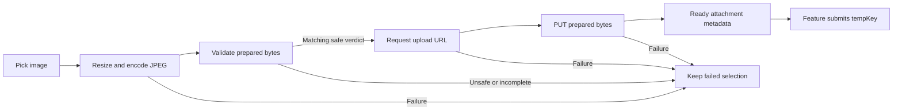

# Shared image upload

Reference integration for `core/media/upload`. Keep the preparation, validation, upload and commit
responsibilities below when adapting the feature. Package names, storage folders and payloads are
examples; confirm the consuming service contract. This document does not assert these classes
are already installed in the base.

## Required sequence



Validation and storage receive the same prepared bytes. Failure before obtaining a target blocks
storage upload. Upload success prepares an attachment; the feature still owns the final commit.
The validation step applies when required by the integrated service.

## Repository entry point

Reference types live under `com.example.app.core.media.upload`; replace that example package with
the consuming application's package. Inject the repository interface into a feature repository or
helper instead of calling the compressor, moderation API and storage client from its ViewModel.

```kotlin
/** Prepares and uploads media for a feature-owned commit. */
suspend fun uploadForCommit(
    source: UploadSource,
    folder: MediaFolder,
): ApiResult<UploadedMedia>
```

| Input | Meaning |
| --- | --- |
| `UploadSource.uri` | Readable content URI or local file path |
| `UploadSource.fileName` | Safe filename without directory segments |
| `UploadSource.contentType` | Resolved MIME type; do not relabel images to bypass validation |
| `MediaFolder` | Service-supported category; only a few example categories are needed |

```kotlin
val result = mediaUploadRepository.uploadForCommit(
    source = UploadSource(
        uri = selectedUri,
        fileName = "photo.jpg",
        contentType = selectedMimeType,
    ),
    folder = MediaFolder.EXAMPLE,
)
```

`MediaFolder.EXAMPLE` stands for an actual supported folder, not a new enum to add automatically.
The reference repository prepares a unique JPEG filename and uploads as `image/jpeg`.

| Result | Feature action |
| --- | --- |
| `ApiResult.Success<UploadedMedia>` | Associate metadata with the same selection and mark ready |
| `ApiResult.Error` | Keep failed selection; apply agreed presentation and block invalid submission |
| `ApiResult.Loading` | Not a completed attachment; keep submission blocked |

| `UploadedMedia` field | Usage |
| --- | --- |
| `tempKey` | Key for the final feature commit |
| `tempPublicUrl` | Optional temporary preview URL |
| `publicUrl` | Optional public URL supplied by the service |
| `previewUrl` | `tempPublicUrl ?: publicUrl`; local preview may remain when null |

Retain matching metadata when retrying the final business request while its temporary key remains
valid. Re-uploading repeats preparation and transport; it does not deduplicate a previous commit.
Temporary-key lifetime is service-owned.

## Preparation reference

The original reusable compressor uses the following example configuration. Keep limits configurable
and verify them against the new service rather than treating them as universal requirements.

| Setting | Example value |
| --- | --- |
| Output | JPEG, `image/jpeg` |
| Maximum long edge | 1,600 px |
| Maximum encoded size | 5 MiB |
| Intermediate decode budget | 4,000,000 pixels |
| Quality | Start at 90, reduce to 50, then reduce dimensions as needed |

Apply EXIF orientation and define transparency flattening. The repository owns prepared cache files
and removes them after completion, error or cancellation. Never delete original user files. Retain
URI access for the lifetime of the draft. A standalone pre-save validation may reuse preparation,
but does not bypass validation of the final edited/cropped bytes.

## HTTP reference

The following paths and fields preserve the sample integration shape. They concern media only;
the removal of backend payment verify/status/restore does not remove media APIs.

### 1. Validate the prepared image

Example `POST api/v1/media/validate`, multipart file part `images`, one prepared file per request.
Let the HTTP library calculate multipart boundaries. Match the verdict to the generated filename.

```json
{
  "status": "success",
  "statusCode": 200,
  "data": {
    "results": [{"filename": "validation_example.jpg", "unsafe": false}],
    "message": null
  }
}
```

Require an explicit matching safe verdict. Unsafe, missing or mismatched verdicts and unsuccessful
response envelopes block upload. Do not assume an empty response means safe.

### 2. Request an upload target

Example `POST api/v1/media/upload-url`:

```json
{"fileName": "photo_example.jpg", "contentType": "image/jpeg", "folder": "example"}
```

Require `uploadUrl` and `tempKey`. A legacy `key` fallback is used only if the service explicitly
supports it. Optional preview/public URLs map into `UploadedMedia`.

### 3. Upload and commit

PUT the prepared bytes to `uploadUrl` with `Content-Type: image/jpeg`. Use a dedicated storage
client that does not attach application auth/signature headers to presigned destinations. Only a
successful PUT marks ready. The feature then submits `tempKey` in its own business request.

## Batch preparation example

The following helper uses reference repository/model types plus standard coroutine APIs:

```kotlin
import kotlinx.coroutines.async
import kotlinx.coroutines.awaitAll
import kotlinx.coroutines.coroutineScope
import kotlinx.coroutines.sync.Semaphore
import kotlinx.coroutines.sync.withPermit

/** Prepares images concurrently and returns results in selection order. */
suspend fun prepareImages(
    repository: MediaUploadRepository,
    sources: List<UploadSource>,
    folder: MediaFolder,
    maxConcurrent: Int,
): List<ApiResult<UploadedMedia>> = coroutineScope {
    require(maxConcurrent > 0)
    val permits = Semaphore(maxConcurrent)
    sources.map { source ->
        async {
            permits.withPermit { repository.uploadForCommit(source, folder) }
        }
    }.awaitAll()
}
```

Choose bounded concurrency for bitmap memory. Repository failures remain per-image; propagate
coroutine cancellation. To show thumbnails as each completes, publish each result from its own job.

## UI state and errors

`Selected → Preparing → Ready(UploadedMedia) | Failed(ApiResult.Error)`

For prepare-on-pick flows, submission requires valid feature inputs and every selected image ready.
Removal clears the blocker and metadata; replacement cancels the old job and starts a new one.
Use stable selection IDs/generations to reject late callbacks even if HTTP cancellation is delayed.

| Failure | Handling reference |
| --- | --- |
| Unsafe verdict | Typed validation error and approved safety copy |
| Cannot meet size limit | Typed size-limit error and feature fallback |
| Backend failure | Joined `details[].message`, then `message`, feature, generic |
| Connectivity failure | Offline copy only for actual connectivity failures |
| Decode, missing verdict/target, storage failure | Appropriate typed failure; never raw exception/body |

Keep caption and failed selection for the agreed removal/replacement/retry flow. Confirm inline
versus shell-snackbar presentation and reconnect retry before implementation. Do not copy an old
feature's exact error resources, close-button artwork or automatic retry policy.

Reference components such as `ChatComposerController`, `ChatImageUploadState` and shared composer
UI can be reused if present in the consuming app; check source rather than inventing imports.

## Verification

Review large-image memory, EXIF, URI access, invalid verdicts, target/PUT failures, commit retry,
replacement/removal, stale callbacks and cache cleanup. No runtime checks are claimed. Unit,
instrumented and Maestro runs require explicit authorization.
